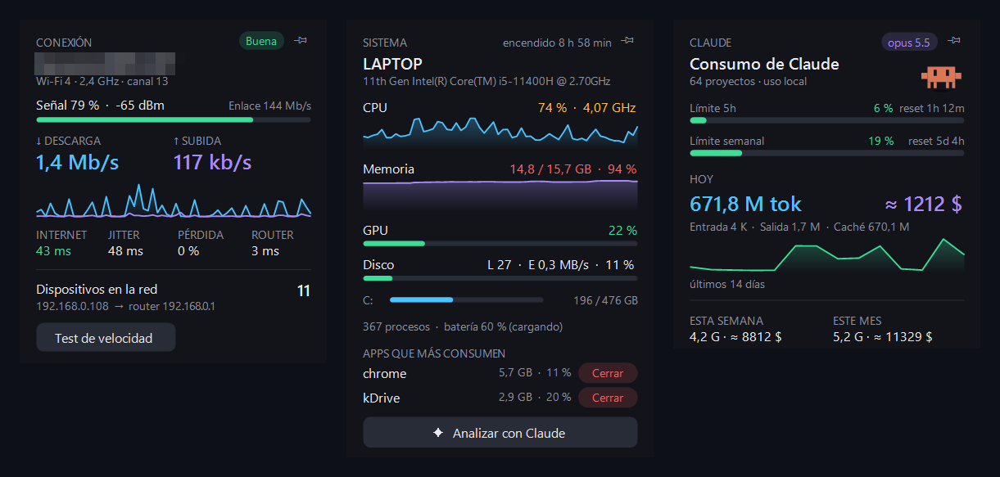

# DeskWidgets

Tres widgets de escritorio nativos para Windows 10/11 en un único proceso ligero (~90 MB de RAM con PowerShell de anfitrión, <0,1 % de CPU). Sin dependencias ni instaladores: se compilan con el compilador de C# que ya trae .NET Framework 4.8.



| Widget | Qué muestra |
|---|---|
| **Conexión** | SSID, estándar Wi-Fi, banda y canal, señal en % y dBm, velocidad de enlace, descarga/subida en vivo con gráfica de 60 s, latencia a 1.1.1.1, jitter, pérdida de paquetes, latencia al router, dispositivos en la red y test de velocidad bajo demanda (Cloudflare). |
| **Sistema** | CPU (mismo % que el Administrador de tareas, GHz actuales), RAM, GPU, actividad de disco y MB/s, espacio de cada unidad, tiempo encendido, procesos y batería. Incluye **cerrar apps pesadas** y **análisis con Claude**. |
| **Claude** | Consumo de Claude Code: tokens de hoy/semana/mes, coste equivalente a precios API, gráfica de 14 días, y barras de progreso de los límites de **5 h** y **semanal** del plan. |

## Requisitos

- **Windows 10 o 11** (incluye .NET Framework 4.8, así que `csc.exe` ya está presente — no hace falta instalar nada).
- **PowerShell** (el de serie en Windows).

Los widgets de **Conexión** y **Sistema** funcionan sin nada más. Lo relacionado con Claude depende de lo que tengas instalado:

| Función | Qué necesita |
|---|---|
| Tokens y coste de hoy/semana/mes, gráfica de 14 días | [Claude Code](https://claude.com/claude-code) usado en esta máquina. El widget lee sus transcripts locales (`%USERPROFILE%\.claude\projects`); no necesita sesión abierta, API key ni plugins. |
| Barras de límite de **5 h** y **semanal** | Claude Code con una **suscripción** (Pro/Max) y el plugin **`sub-meter`** de [better-claude](https://github.com/midudev/better-claude). Con API key no hay límites que mostrar. |
| **Analizar con Claude** | Claude Code con sesión iniciada y el comando `claude` como `claude.exe` en el `PATH` (lo deja así el instalador nativo). |

Sin esas piezas el widget no falla: muestra ceros o «sin datos» en lo que falte.

### Configurar Claude Code (opcional)

1. Instala Claude Code con el instalador nativo e inicia sesión:
   ```powershell
   irm https://claude.ai/install.ps1 | iex
   claude
   ```
   Comprueba que `where.exe claude` devuelve un `claude.exe`. Si lo instalaste con `npm`, el comando es `claude.cmd` y el botón **Analizar con Claude** no lo encuentra; el resto del widget funciona igual.
2. Para las barras de 5 h y semanal, dentro de Claude Code:
   ```text
   /plugin marketplace add midudev/better-claude
   /plugin install sub-meter@better-claude
   ```
   Reinicia Claude Code y envía un mensaje. A partir de esa respuesta el plugin guarda la lectura en `%USERPROFILE%\.claude\plugins\store\sub-meter_*.json`, que es lo que lee el widget.

Instalar better-claude antes o después de los widgets da igual: el widget comprueba el fichero en cada refresco.

## Instalación en otra máquina

1. Clona el repo (o copia la carpeta):
   ```powershell
   git clone https://github.com/agenciaRSE/deskwidgets.git
   cd deskwidgets
   ```
2. Ejecuta el instalador por usuario (no requiere administrador):
   ```powershell
   powershell -ExecutionPolicy Bypass -File .\install.ps1
   ```
   Compila `DeskWidgets.dll`, lo copia a `%LOCALAPPDATA%\Programs\DeskWidgets`, crea el acceso directo del menú Inicio, lo activa al iniciar Windows y lo abre.

Para desinstalar (quita autoarranque, acceso directo y archivos; conserva los ajustes):
```powershell
powershell -ExecutionPolicy Bypass -File .\install.ps1 -Uninstall
```

### Probar sin instalar

```powershell
powershell -ExecutionPolicy Bypass -File .\build.ps1                 # compila DeskWidgets.dll
powershell -Sta -ExecutionPolicy Bypass -File .\DeskWidgets.ps1      # lo ejecuta
```

## Smart App Control

Smart App Control (Windows 11) bloquea los ejecutables sin firmar, **aunque los hayas compilado tú**. Por eso la app no es un `.exe`: se compila como `DeskWidgets.dll` y la abre `DeskWidgets.ps1`, que carga el ensamblado en memoria dentro de `powershell.exe` (firmado por Microsoft).

- No hay que desactivar Smart App Control (en Windows 11 es irreversible).
- No es una vía aprobada por SAC. Si una actualización de Windows cerrara este hueco, la alternativa limpia es firmar el binario con un certificado de confianza pública (p. ej. Azure Artifact Signing) y arrancarlo como `.exe`.

## Uso

- Arrastra un widget para moverlo. La posición se guarda en `%APPDATA%\DeskWidgets\settings.ini`.
- La chincheta de la esquina superior derecha fija ese widget por encima de cualquier ventana, para seguirlo mientras trabajas; otro clic lo devuelve al escritorio. Se recuerda por widget.
- Clic derecho en un widget, o en el icono de la bandeja, para mostrar u ocultar cada widget, fijarlos todos encima, iniciar con Windows o salir.
- **Cerrar apps pesadas** (widget de sistema): la sección «Apps que más consumen» lista las apps con ventana que más RAM/CPU gastan, con un botón **Cerrar** que pide confirmación y cierra todas sus instancias de tu sesión.
- **Analizar con Claude** (widget de sistema o menú): envía a Claude el estado del PC, los procesos que más gastan y la red con los dispositivos de la LAN, y devuelve un diagnóstico con acciones (cerrar procesos, bloquear un dispositivo en el router). Usa tu suscripción vía Claude Code en modo headless (`claude -p`), sin API key.

## Cómo funciona

Todo se lee con APIs nativas, sin lanzar `netsh`, `typeperf` ni WMI:

| Dato | Fuente |
|---|---|
| Wi-Fi | `wlanapi.dll` (`WlanQueryInterface`) |
| Tráfico | diferencias de `NetworkInterface.GetIPStatistics()` |
| Dispositivos | barrido de ping del /24 cada 3 min y después la tabla ARP (`GetIpNetTable`) |
| CPU, GPU, disco | PDH con rutas de contador en inglés (`PdhAddEnglishCounter`), así funciona también en Windows en español |
| RAM, tiempo encendido | `GlobalMemoryStatusEx`, `GetTickCount64` |
| Consumo de Claude | transcripts `~/.claude/projects/**/*.jsonl`, leídos de forma incremental (solo los bytes nuevos de cada fichero) |
| Límites 5 h / semanal | plugin `sub-meter` de better-claude (`~/.claude/plugins/store/sub-meter_*.json`: `percentUsed` + `resetsAt`) |

El coste del widget de Claude es **equivalente a precios de la API** (entrada/salida/caché por familia de modelo), no lo que pagas con la suscripción; sirve para ver el valor real del uso.

## Límites

- Sin temperaturas: Windows solo las expone a procesos con permisos de administrador o a drivers del fabricante.
- En modo escritorio, Win+D oculta los widgets como cualquier otra ventana.
- El escaneo de dispositivos solo cubre el /24 de tu IP; los que no responden a ARP no aparecen.
- No hay ancho de banda por proceso (requiere ETW): «Apps que más consumen» ordena por RAM/CPU.
- Las barras de 5 h y semanal solo se refrescan mientras Claude Code está en ejecución (es quien actualiza el fichero de `sub-meter`).

## Estructura

```
build.ps1          Compila src\*.cs → DeskWidgets.dll (csc.exe de .NET Framework 4.8)
DeskWidgets.ps1    Lanzador: carga el .dll en memoria dentro de powershell.exe
install.ps1        Instala/desinstala por usuario (-Uninstall)
src\Widget.cs      Base: ventana sin borde, DPI-aware, helpers de dibujo, botones/zonas
src\NetWidget.cs   Widget de conexión
src\PcWidget.cs    Widget de sistema (+ cerrar apps, + botón de análisis)
src\ClaudeWidget.cs Widget de consumo de Claude
src\Advisor.cs     Análisis con Claude (prompt, esquema JSON, cierre de procesos)
src\Native.cs      P/Invoke (WlanAPI, PDH, ARP, memoria, DWM)
src\Program.cs     Arranque, bandeja, menú, un único proceso
docs\widgets.png   Captura del README
```

## Licencia

[MIT](LICENSE). El plugin `sub-meter` es de [better-claude](https://github.com/midudev/better-claude) (MIT, midudev) y no se incluye aquí.
