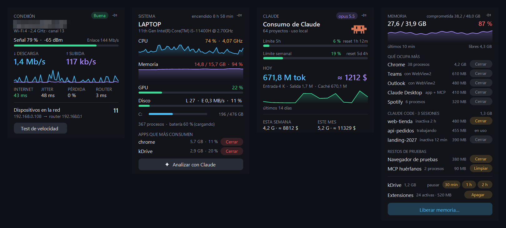

# DeskWidgets

Cuatro widgets de escritorio nativos para Windows 10/11 en un único proceso ligero (~90 MB de RAM con PowerShell de anfitrión, <0,1 % de CPU). Sin dependencias ni instaladores: se compilan con el compilador de C# que ya trae .NET Framework 4.8.



| Widget | Qué muestra |
|---|---|
| **Conexión** | SSID, estándar Wi-Fi, banda y canal, señal en % y dBm, velocidad de enlace, descarga/subida en vivo con gráfica de 60 s, latencia a 1.1.1.1, jitter, pérdida de paquetes, latencia al router, dispositivos en la red y test de velocidad bajo demanda (Cloudflare). |
| **Sistema** | CPU (mismo % que el Administrador de tareas, GHz actuales), RAM, GPU, actividad de disco y MB/s, espacio de cada unidad, tiempo encendido, procesos y batería. Incluye **cerrar apps pesadas** y **análisis con Claude**. |
| **Claude** | Consumo de Claude Code: tokens de hoy/semana/mes, coste equivalente a precios API, gráfica de 14 días, y barras de progreso de los límites de **5 h** y **semanal** del plan. |
| **Memoria** | Para cuando hace falta liberar RAM: uso y memoria comprometida con gráfica de 10 min, lo que más ocupa agrupado como tú lo reconoces (Chrome, cada sesión de Claude Code con sus MCP, Claude Desktop, apps con WebView2, navegadores de agent-browser, MCP huérfanos), y acciones para cerrarlo, **pausar kDrive** 30 min / 1 h / 2 h y **apagar o encender las extensiones de Chrome**. |

## Requisitos

- **Windows 10 o 11** (incluye .NET Framework 4.8, así que `csc.exe` ya está presente — no hace falta instalar nada).
- **PowerShell** (el de serie en Windows).

Los widgets de **Conexión** y **Sistema** funcionan sin nada más. Lo relacionado con Claude depende de lo que tengas instalado:

| Función | Qué necesita |
|---|---|
| Tokens y coste de hoy/semana/mes, gráfica de 14 días | [Claude Code](https://claude.com/claude-code) usado en esta máquina. El widget lee sus transcripts locales (`%USERPROFILE%\.claude\projects`); no necesita sesión abierta, API key ni plugins. |
| Barras de límite de **5 h** y **semanal** | Claude Code con una **suscripción** (Pro/Max) y el plugin **`sub-meter`** de [better-claude](https://github.com/midudev/better-claude). Con API key no hay límites que mostrar. |
| **Analizar con Claude** | Claude Code con sesión iniciada y el comando `claude` como `claude.exe` en el `PATH` (lo deja así el instalador nativo). |
| Sesiones de Claude Code en el widget de memoria | Claude Code reciente: el widget lee `%USERPROFILE%\.claude\sessions\<pid>.json` (proyecto, estado `idle`/`busy`). Sin ese fichero la sesión sale como «claude &lt;pid&gt;» y no se puede cerrar. |
| Apagar/encender extensiones de Chrome | La extensión [Disable All Extensions](https://chromewebstore.google.com/detail/disable-all-extensions/ailfldpmpboolaihojfagmmfbhcgohne) en el perfil principal de Chrome, con un atajo de teclado (ver [Uso](#uso)). |

Sin esas piezas el widget no falla: muestra ceros o «sin datos» en lo que falte.

### Configurar Claude Code (opcional)

1. Instala Claude Code con el instalador nativo e inicia sesión:
   ```powershell
   irm https://claude.ai/install.ps1 | iex
   claude
   ```
   Comprueba que `where.exe claude` devuelve un `claude.exe`. Si lo instalaste con `npm`, el comando es `claude.cmd` y el botón **Analizar con Claude** no lo encuentra; el resto del widget funciona igual.
2. Para las barras de 5 h y semanal, dentro de Claude Code:
   ```text
   /plugin marketplace add midudev/better-claude
   /plugin install sub-meter@better-claude
   ```
   Reinicia Claude Code y envía un mensaje. A partir de esa respuesta el plugin guarda la lectura en `%USERPROFILE%\.claude\plugins\store\sub-meter_*.json`, que es lo que lee el widget.

Instalar better-claude antes o después de los widgets da igual: el widget comprueba el fichero en cada refresco.

## Instalación en otra máquina

1. Descarga el `.zip` de la [última versión](https://github.com/agenciaRSE/deskwidgets/releases/latest) y descomprímelo, o clona el repo:
   ```powershell
   git clone https://github.com/agenciaRSE/deskwidgets.git
   cd deskwidgets
   ```
2. Ejecuta el instalador por usuario (no requiere administrador):
   ```powershell
   powershell -ExecutionPolicy Bypass -File .\install.ps1
   ```
   Compila `DeskWidgets.dll`, lo copia a `%LOCALAPPDATA%\Programs\DeskWidgets`, crea el acceso directo del menú Inicio, lo activa al iniciar Windows y lo abre.

Para desinstalar (quita autoarranque, acceso directo y archivos; conserva los ajustes):
```powershell
powershell -ExecutionPolicy Bypass -File .\install.ps1 -Uninstall
```

### Probar sin instalar

```powershell
powershell -ExecutionPolicy Bypass -File .\build.ps1                 # compila DeskWidgets.dll
powershell -Sta -ExecutionPolicy Bypass -File .\DeskWidgets.ps1      # lo ejecuta
```

## Smart App Control

Smart App Control (Windows 11) bloquea los ejecutables sin firmar, **aunque los hayas compilado tú**. Por eso la app no es un `.exe`: se compila como `DeskWidgets.dll` y la abre `DeskWidgets.ps1`, que carga el ensamblado en memoria dentro de `powershell.exe` (firmado por Microsoft).

- No hay que desactivar Smart App Control (en Windows 11 es irreversible).
- No es una vía aprobada por SAC. Si una actualización de Windows cerrara este hueco, la alternativa limpia es firmar el binario con un certificado de confianza pública (p. ej. Azure Artifact Signing) y arrancarlo como `.exe`.

## Uso

- Arrastra un widget para moverlo. La posición se guarda en `%APPDATA%\DeskWidgets\settings.ini`.
- La chincheta de la esquina superior derecha fija ese widget por encima de cualquier ventana, para seguirlo mientras trabajas; otro clic lo devuelve al escritorio. Se recuerda por widget.
- Clic derecho en un widget, o en el icono de la bandeja, para mostrar u ocultar cada widget, fijarlos todos encima, iniciar con Windows o salir.
- **Cerrar apps pesadas** (widget de sistema): la sección «Apps que más consumen» lista las apps con ventana que más RAM/CPU gastan, con un botón **Cerrar** que pide confirmación y cierra todas sus instancias de tu sesión.
- **Widget de memoria**: cada fila tiene su botón y todos piden confirmación.
  - **Sesión de Claude Code**: cierra Claude y sus procesos (MCP, shells). Solo se puede si está inactiva; si está trabajando o esperando tu respuesta sale «en uso». Al cerrarla copia al portapapeles `cd "<proyecto>"; claude --resume <id>` para seguir la conversación. Las inactivas desde hace 30 min o más salen en ámbar.
  - **Navegador de pruebas**: el Chrome que abre `agent-browser`, con la web que tenía abierta.
  - **MCP huérfanos**: servidores MCP (`node`) cuyo proceso padre ya no existe. Los que tiene abiertos una app viva (Warp, VS Code, Raycast…) no salen aquí.
  - **Cerrar una app** pide a sus ventanas que se cierren (Chrome guarda las pestañas) y termina lo que quede. Si es el terminal donde corren sesiones de Claude Code, el aviso lo dice.
  - **Pausar kDrive** lo cierra (libera su RAM) y lo vuelve a abrir solo a la hora indicada. La hora se guarda en `settings.ini`: si los widgets se reinician, la pausa sigue; si los cierras con «Salir», kDrive se reabre antes. Si lo abres tú antes, la pausa se olvida.
  - **Extensiones**: muestra cuántas extensiones hay activas en el perfil principal y cuánta RAM gastan sus procesos. La primera vez sale «Configurar»: en `chrome://extensions/shortcuts`, en «Disable All Extensions» › «Activar la extensión», pon `Ctrl+Shift+8` (el ámbito «En Chrome» vale: Chrome no permite «Global» para esta acción). Después, el botón trae un momento al frente una ventana de tu Chrome y pulsa el atajo. Comprueba en el almacenamiento de la extensión que ha cambiado, y si no, prueba con otra ventana (por si era de un perfil sin la extensión). Luego te devuelve a la app en la que estabas. La extensión apaga todas las que no estén en su lista blanca, o vuelve a encenderlas.
- **Liberar memoria…** (botón del widget de memoria o menú de la bandeja): panel con un escaneo nuevo en dos bloques.
  - **Recomendado · sin riesgo**, ya marcado: MCP huérfanos, navegadores de pruebas y sesiones de Claude Code inactivas desde hace 30 min o más.
  - **Más opciones**, sin marcar, de menos a más intrusivo: sesiones recientes, pausar kDrive 1 h, apagar las extensiones de Chrome y cerrar apps. No ofrece el terminal donde corren sesiones de Claude Code.
  - El botón muestra lo que vas a liberar. Al terminar enseña la RAM antes y después, copia los comandos para reanudar las sesiones cerradas y dice a qué hora vuelve kDrive.
- **Aviso de memoria**: si la RAM se queda al 85 % o más durante 30 s, sale un globo en la bandeja con lo que más ocupa y lo que se puede liberar sin riesgo. Al pulsarlo se abre el panel. No se repite hasta que la RAM baje del 80 %, y como mucho uno cada 20 min. Se desactiva en el menú: «Avisar si la memoria pasa del 85 %».
- **Analizar con Claude** (widget de sistema o menú): envía a Claude el estado del PC, los procesos que más gastan y la red con los dispositivos de la LAN, y devuelve un diagnóstico con acciones (cerrar procesos, bloquear un dispositivo en el router). Usa tu suscripción vía Claude Code en modo headless (`claude -p`), sin API key.

## Cómo funciona

Todo se lee con APIs nativas, sin lanzar `netsh`, `typeperf` ni WMI:

| Dato | Fuente |
|---|---|
| Wi-Fi | `wlanapi.dll` (`WlanQueryInterface`) |
| Tráfico | diferencias de `NetworkInterface.GetIPStatistics()` |
| Dispositivos | barrido de ping del /24 cada 3 min y después la tabla ARP (`GetIpNetTable`) |
| CPU, GPU, disco | PDH con rutas de contador en inglés (`PdhAddEnglishCounter`), así funciona también en Windows en español |
| RAM, tiempo encendido | `GlobalMemoryStatusEx`, `GetTickCount64` |
| Consumo de Claude | transcripts `~/.claude/projects/**/*.jsonl`, leídos de forma incremental (solo los bytes nuevos de cada fichero) |
| Límites 5 h / semanal | plugin `sub-meter` de better-claude (`~/.claude/plugins/store/sub-meter_*.json`: `percentUsed` + `resetsAt`) |
| Procesos y memoria (widget de memoria) | `NtQuerySystemInformation(SystemProcessInformation)`: todos los procesos con padre, fecha de creación y **conjunto de trabajo privado** (la columna «Memoria» del Administrador de tareas) en una sola llamada. Cada 3 s, ~6 ms |
| Línea de comandos | `NtQueryInformationProcess` (clase 60), solo de chrome, claude, node y kDrive, en caché por PID + fecha de creación |
| Estado de las extensiones | `Secure Preferences` (activas), `Preferences` (atajo) y el log LevelDB de `chrome.storage.sync` de la extensión (`isDisablingOtherExts`) |

El coste del widget de Claude es **equivalente a precios de la API** (entrada/salida/caché por familia de modelo), no lo que pagas con la suscripción; sirve para ver el valor real del uso.

## Límites

- Sin temperaturas: Windows solo las expone a procesos con permisos de administrador o a drivers del fabricante.
- En modo escritorio, Win+D oculta los widgets como cualquier otra ventana.
- El escaneo de dispositivos solo cubre el /24 de tu IP; los que no responden a ARP no aparecen.
- No hay ancho de banda por proceso (requiere ETW): «Apps que más consumen» ordena por RAM/CPU.
- El widget de memoria no «limpia» la RAM vaciando working sets ni la lista standby: es cosmético (Windows la vuelve a llenar) y lo segundo exige administrador. Libera memoria cerrando cosas.
- Chrome no deja ver la memoria de cada pestaña ni desactivar extensiones desde fuera: por eso se usa Disable All Extensions. Solo actúa sobre el perfil principal (`Default`).
- Cerrar un proceso lo mata; para cerrar una sesión de Claude Code eso no pierde nada (el historial ya está guardado), pero sí lo que una app no haya guardado si no responde al cierre normal.
- Las barras de 5 h y semanal solo se refrescan mientras Claude Code está en ejecución (es quien actualiza el fichero de `sub-meter`).
- Si un cuelgue deja ese fichero lleno de bytes nulos, sub-meter ya no lo reescribe. El widget lo detecta, lo mueve a `%TEMP%\sub-meter_*.corrupt.json` y muestra «regenerando…» hasta que sub-meter crea uno nuevo (segundos, con Claude Code abierto).

## Estructura

```
build.ps1          Compila src\*.cs → DeskWidgets.dll (csc.exe de .NET Framework 4.8)
DeskWidgets.ps1    Lanzador: carga el .dll en memoria dentro de powershell.exe
install.ps1        Instala/desinstala por usuario (-Uninstall)
src\Widget.cs      Base: ventana sin borde, DPI-aware, helpers de dibujo, botones/zonas
src\NetWidget.cs   Widget de conexión
src\PcWidget.cs    Widget de sistema (+ cerrar apps, + botón de análisis)
src\ClaudeWidget.cs Widget de consumo de Claude
src\MemWidget.cs   Widget de memoria (+ pausa de kDrive, + extensiones de Chrome)
src\MemScan.cs     Lista de procesos, agrupación por app/sesión y cierre de grupos
src\FreePanel.cs   Panel «Liberar memoria» (sugerencias, progreso, resultado)
src\Advisor.cs     Análisis con Claude (prompt, esquema JSON, cierre de procesos)
src\Native.cs      P/Invoke (WlanAPI, PDH, ARP, memoria, DWM)
src\Program.cs     Arranque, bandeja, menú, un único proceso
docs\widgets.png   Captura del README
```

## Licencia

[MIT](LICENSE). El plugin `sub-meter` es de [better-claude](https://github.com/midudev/better-claude) (MIT, midudev) y no se incluye aquí.
